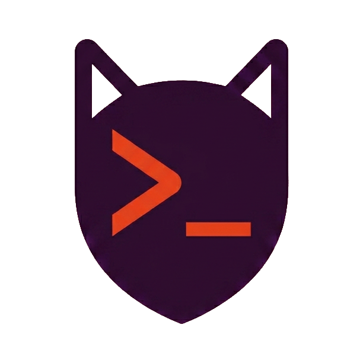

= KaTTY
:toc: macro
:toclevels: 2
:idprefix:
:idseparator: -
:icons: font

[.lead]
*A terminal manager for people who run several coding agents at once.*

KaTTY keeps your terminals organized in projects and workspaces, and shows at a glance what each agent in them is doing: working, waiting for you, or done.
You start the agents yourself, in plain terminals, with the tools you already use.
KaTTY displays and arranges them, and never reads or writes what an agent says.

It is for you if you work on several repositories, or several tasks in one repository, with Claude Code, Codex or another agent running in each, and you are tired of hunting for the window that needs you.

toc::[]

== What you get

=== Organize your work

* A *project* is a folder on your disk.
It holds *workspaces*, and each workspace holds terminals in a layout of splits.
* Split a terminal right or down, drag the gap between panes to resize them, maximize one pane to focus on it, and move a terminal to another workspace of its project.
* Rename projects, workspaces and terminals, and drag projects and workspaces to reorder them.
* Show the usage of your agents in the panel, in a window of its own for another screen, or not at all, from the settings menu.
* Open again a project that you removed: right-click the add project button, or run "Open recent project…" in the command palette, to pick among the last 50 that are not open.
* Open a project's folder in an editor or IDE from its right-click menu (*Open in*) or the command palette: Visual Studio Code, the JetBrains IDEs, Android Studio, Xcode, Eclipse, Sublime Text and others, each only when it is installed.
* Three layouts: *horizontal*, with a sidebar that folds into a slim rail; *vertical*, with tabs along the top; and *auto*, which picks the vertical one when the window is taller than it is wide.
* Light, dark or system theme.
* The text of the application can be made bigger, up to 175 %, or smaller, in the main menu, for the people who read better with a larger text.
The font of the terminals is a setting of its own.
* The window comes back where you left it, in the same size and mode, and so does the board window.
* The command palette (⌘K) finds any project, workspace, terminal or command, and shows the shortcut of each command.

=== See what your agents are doing

* Every terminal, workspace and project shows the state of its agents: working, needs you, done or failed.
The sidebar counts how many terminals are in each state.
* The *agent board* gathers every agent in a column for its state: nothing, working, needs input, done.
Filter it by project, and open it in a window of its own to keep it on another screen.
A click on a card brings you to that terminal.
* The bell in the title bar lists the agents that need you or have finished.
⌘⇧J jumps to the next agent that waits.
* When an agent you are not looking at needs you, finishes or fails, a notice appears in the window.
KaTTY does not send macOS notifications, badges or sounds.
* The header of each pane shows the agent or the program that runs in it, and the *git branch*, worktree or commit that the terminal is in.
A workspace whose terminals are all in the same branch says it too, under its name in the sidebar and beside it in the tabs.
* Closing a workspace asks first when an agent in it is still working or waiting for you.

How much of this each agent supports is in <<agent-compatibility,the compatibility matrix>>.

=== Keep an eye on your usage

* Quota bars show how much of each limit of your agents you have used, and when it resets.
They turn amber from 80 %.
* You choose which agents and which limits are shown, and can fold them into a compact form.
* The numbers are read from the agents' own usage commands, every two minutes or when you press refresh.
It costs no turn, and no credential is ever read.

=== Pick up where you left off

* The projects, workspaces, splits, names and settings are kept as you change them.
* When you open KaTTY again, each terminal starts a new shell in the folder where the old one was.
* The program that was running is started again over the shell, with the same command line and in the same folder: an `emacs notes.txt` reopens the file, and leaving emacs leaves you at the shell prompt.
* An agent that can pick up its conversation does: Claude Code, Antigravity, Copilot CLI and Junie are started again on their last conversation, with the same model and permissions.
* A program that only shows something or waits for you starts by itself: editors, pagers, monitors, terminal multiplexers, the agents, a REPL and `ssh` to a host.
Any other command, such as `make deploy` or `rm`, is only typed at the prompt and waits for you to press Return.
A command that starts with `sudo`, `doas` or `su` is never started again.
* The scrollback is not kept, and neither is what a program held in memory, such as an unsent prompt or the unsaved buffers of an editor.

=== A terminal you will enjoy

* 811 color schemes, with a picker that has a search, a light and dark filter and a live preview, and a scheme of its own for any terminal.
* The bundled JetBrains Mono, or any monospaced font of your system, from 8 to 32 points, with ligatures on or off.
* A block or a bar cursor, blinking or steady, that the shell puts back at each prompt.
* Select with the mouse by word, by line or by block, or with Shift and the arrow keys.
Copy and paste are safe: what you paste cannot run commands behind your back.
A middle click pastes the last selection.
* Find in the terminal (⌘F), and jump from prompt to prompt (⌘↑ and ⌘↓) with zsh and bash.
* ⌘-click opens the links that programs print, and the addresses written in the text.
* Images appear in the terminal: the Kitty graphics protocol.
* The history has a scrollbar that hides when you do not use it.
* The macOS line-editing keys work in the shell: ⌥← and ⌥→ move by word, ⌘← and ⌘→ go to the start and the end of the line, ⌘⌫ deletes to the start.
* Dead keys and accents work, and programs that use the mouse or the Kitty keyboard protocol get them.
A program can put text in your clipboard, and cannot read it.
* When a program rings the terminal bell, a small ring pulses around the cursor, even if the program has hidden it, and nothing else on the screen changes.

== Keyboard shortcuts

Everything in KaTTY can be done without the mouse.
The shortcuts below are the defaults: every one of them can be changed, removed or put back in the *keyboard shortcuts* window, from the main menu or the palette.
There you choose a shortcut, press the keys that you want, and it applies at once.
A shortcut has to include ⌘, which never reaches the programs in your terminals, and KaTTY refuses the keys that a terminal or the system needs (⌘C, ⌘V, ⌘A, ⌘Q, ⌘Tab…) and asks before it takes keys from another shortcut.
The keys that a terminal handles itself are listed there too, and are fixed.
Every shortcut is also a command of the palette (⌘K), which shows its keys, and so are many things that have no shortcut.
Escape is never used by the window, except to close what is open in front of it (the palette, a dialog, a list): it belongs to the programs in your terminals.

=== Projects, workspaces and panes

[cols="2,3"]
|===
| Shortcut | Action

| ⌘O
| Add a project folder

| ⌘N
| New workspace

| ⌘⇧W
| Close the workspace

| ⌘⇧[, ⌘⇧]
| Previous or next workspace, going on to the other projects at the ends of one

| ⌘⌥[, ⌘⌥]
| Previous or next project, at the workspace where you left it

| ⌘1 … ⌘8, ⌘9
| The first to the eighth workspace of the project, and the last one

| ⌘D
| Split in the main direction of the layout: right in the horizontal layout, down in the vertical one

| ⌘⇧D
| Split the other way

| ⌘⌥ and an arrow
| Move to the neighbouring pane

| ⌘⌥1 … ⌘⌥9
| Go to the first to the ninth pane of the workspace

| ⌘⌃ and an arrow
| Move the nearest divider in that direction

| ⌘⇧↩
| Maximize the pane, or put it back

| ⌘W
| Close the terminal

| ⌘R
| Restart the terminal

| ⌘F2
| Rename the terminal

| ⌘⇧F2
| Rename the workspace

| F2
| Rename the project or the workspace that has the focus in the sidebar or the tabs
|===

When you switch to a workspace, the terminal that you used last in it has the keyboard again.

=== Agents and views

[cols="2,3"]
|===
| Shortcut | Action

| ⌘J
| Show the agents that need you or have finished: ↑ and ↓ choose one, Enter goes to its terminal, Escape closes the list

| ⌘⇧J
| Jump to the next agent that waits

| ⌘⇧B
| Switch between the agent board and the terminals

| ↑ ↓ ← → and Enter
| On the board: move from card to card, and go to the terminal of the one that is selected

| ⌘W
| In the board window: close it

| ⌘B
| Show the project sidebar, or fold it into the rail
|===

=== In a terminal

[cols="2,3"]
|===
| Shortcut | Action

| ⌘F
| Find in the terminal

| ⌘G, ⌘⇧G
| Next or previous match

| ⌘L
| Clear the screen and the scrollback: at a prompt, the shell draws its prompt again at the top

| ⌘↑, ⌘↓
| Jump to the previous or next prompt

| ⌘C, ⌘V, ⌘A
| Copy, paste and select all
|===

=== The look and the menu

[cols="2,3"]
|===
| Shortcut | Action

| ⌘K
| Open the command palette

| ⌘,
| Open the main menu: the layout, the theme, the font

| ⌘=, ⌘-, ⌘0
| Make the font bigger or smaller, or give it its default size
|===

Closing or restarting a terminal asks first while a program other than the shell runs in it.
In a dialog that asks you to confirm, the keyboard starts on the red button: Enter confirms, Escape cancels, Shift+Tab goes to Cancel, and ⌘⌫ confirms at once.

[#agent-compatibility]
== Agent compatibility

KaTTY knows these agents by name: it recognizes them, shows their logo, and finds out which of them are installed on your machine.
What more it can do depends on what each agent offers.

Where a cell gives a version, it is the *minimum version*: the first one that tells KaTTY what it is doing, by reporting its state (OSC 7501).
Older versions look like plain shells in the sidebar, and so do Copilot CLI, Junie, Aider, Goose, Cline, Kilo Code, OpenHands and Cursor Agent, which do not report yet.

[cols="2h,3,3,2,4"]
|===
| | Recognized, with its logo, and restarted with its command line options | Live state report and card on the agent board | Usage meter | Resumes last conversation after relaunch

| Claude Code
| Yes
| 2.1.295
| 2.1.118
| Yes (undocumented)

| Codex
| Yes
| 0.163.0
| 0.48.0
| No

| Antigravity
| Yes
| 1.4.0
| 1.1.11
| Yes (undocumented)

| Copilot CLI
| Yes
| No
| No
| 1.0.22

| Junie
| Yes
| No
| No
| Yes (undocumented)

| OpenCode
| Yes
| 2.1.0
| 1.2.0
| 2.1.0

| Crush
| Yes
| 0.98.0
| No
| 0.51.0 (one per dir)

| Aider
| Yes
| No
| No
| 0.35.0 (one per dir)

| Goose
| Yes
| No
| No
| 1.13.0 (one per dir)

| Cline
| Yes
| No
| No
| 3.0.66

| Kilo Code
| Yes
| No
| 7.2.44
| 7.2.44

| Pi
| Yes (not its options)
| 1.1.0
| No
| No

| Oh My Pi (omp)
| Yes
| 18.8.7
| 16.1.15
| 18.4.9

| OpenHands
| Yes
| No
| No
| 1.7.1 (one per dir)

| Cursor Agent
| Yes
| No
| No
| 2026.10.19 (one per dir)
|===

*Yes* means it works, as far as it was tried, and a version number means it works from that version on.
*No* means it is not available.

NOTE: *one per dir* means that two of that agent in the same directory cannot be told apart.
Crush, Goose, OpenHands and Cursor Agent give KaTTY nothing that ties a running process to its conversation, so it takes the newest conversation of the directory since the process started.
Aider keeps one chat file for each directory, which every Aider started there writes to.
When another terminal of KaTTY runs the same agent in the same directory, KaTTY resumes neither: they come back with no conversation, and not each on the other's.
A terminal that KaTTY itself started on a conversation of its own (`--resume`, `--session`) keeps that one.

WARNING: *Yes (undocumented)* means that resuming relies on files that the agent does not document (where it writes the identifier of its conversation), and may therefore break when the agent changes them: it then starts a new conversation.

* *Live state* comes from the agent itself: KaTTY does not install hooks or read the screen.
An agent that does not report, such as Copilot CLI, Junie, Aider, Goose, Cline, OpenHands, Cursor Agent or an older version of the others, looks like a plain shell in the sidebar and never calls for you.
Copilot CLI will be compatible once https://github.com/github/copilot-cli/issues/5112[this issue] is resolved, and Junie once https://youtrack.jetbrains.com/issue/JUNIE-5904/Support-OSC-7501-Program-Status-escape-sequences-in-Junie-CLI[this one] is.
Goose reports its state since https://github.com/aaif-goose/goose/pull/12928[this change], which is merged but not in a release yet (1.55.0 does not have it): it will be compatible with the next one.
Kilo Code does not report its state yet: https://github.com/Kilo-Org/kilocode/issues/14973[this request] to emit it is open.
* The *agent board* is not a list of known agents: any program that reports its state (OSC 7501) gets a card, whatever it is.
The agents above only add their logo and their name, and a program that does not report has no card.
* The *usage meters* use the agents' own commands.
Claude Code is asked `claude -p /usage`, Antigravity `agy -p /usage` and Codex `codex app-server` (its `account/rateLimits/read` request); none of them costs a turn.
Copilot CLI has no command that gives the usage without costing a turn, so it has no meter.
Junie has none either yet: it will get one once https://youtrack.jetbrains.com/issue/JUNIE-5895/CLI-command-to-query-AI-credit-balance-and-quota[this issue] is resolved.
OpenCode and Kilo Code (whose command line is OpenCode's) have no limit to meter, but the header of their pane and their card on the board show how full the context of their session is (a ring) and what the session cost.
They are read from the agent's own database, read-only: KaTTY asks them nothing and reads no credential. Kilo Code's `kilo stats` is not used: it starts a process that writes a log file each time, and prints boxes for people to read, where the database says the same without that.
A model that the agent does not list (one of your own gateway, or Kilo's `kilo-auto/free`) has a cost and no ring.
In the usage panel they show what they spent today, over the last 7 days and this month, over all their sessions.
Oh My Pi does the same, from its own statistics database (`~/.omp/stats.db`): its `omp stats -j` prints the last 24 hours and nothing else, so KaTTY runs that command only to bring the database up to date (omp does not keep it while it runs, and it takes a third of a second), and reads the periods from the database. The first time, omp makes the database.
Above the agents, one line says how many sessions are open across all the agents and what they cost together: it can be hidden from the chooser, and so can each period.
Antigravity needs version 1.1.11 or later.
* Claude Code, Antigravity, Copilot CLI, Junie, OpenCode, Crush, Aider, Goose, Cline, Kilo Code, Oh My Pi, OpenHands and Cursor Agent resume their conversation.
Codex and Pi start again with no conversation, on purpose: each can start a new conversation inside the program that runs (`/new`), nothing tells which one it is in, and coming back on an older one is worse than a new one.
KaTTY finds the conversation in files that each agent keeps for itself and does not document: after an update that changes them, the agent starts a new conversation instead.
OpenCode's session is the last one that it reported as working or waiting, so two OpenCodes in one directory are told apart once each has worked (before that, and before 2.1.0, it is the newest one of the directory).
Crush's and Goose's session is the newest one of its directory, so two of them in one directory are not told apart.
Cursor Agent makes its chat when it starts, and `/new-chat` makes another at once, with nothing said in it: its conversation is the newest chat of the directory that the process made, and when that one is empty nothing is resumed (it starts again with an empty chat, not on an older one); the chat of its `--resume` is used when it made none. A Cursor Agent started with `--workspace` has its chats elsewhere and starts again with none.
OpenHands keeps nothing of which process a conversation is, so its conversation is the newest one of the directory that was made since the process started (`/new` is followed once a message has been sent), else the one it was resumed with: two OpenHands in one directory are not told apart, and a `/new` with no message after it is not seen (it comes back on the conversation before).
Cline's is the one that its own client has used, so two Clines in one directory are told apart (before 3.0.66 a Cline does not tell its daemon which process it is, and is looked for by its directory, like the others).
Kilo Code's is the one that the log of its own process names when it makes a session (the log is among the files the process has open, and says `sessionId=…`), so two Kilos in one directory are told apart then; a Kilo whose log says nothing is guessed like the others, by the newest conversation of its directory.
Oh My Pi (omp) writes down which session each terminal is in (`~/.omp/agent/terminal-sessions/<tty>`), and KaTTY reads it, so two omps in one directory are told apart and `/new` and `/resume` are followed. A session that has no conversation yet (`fresh`: a new omp, or after `/new`) is not resumed: it starts again with none. An omp started with its own `--profile` keeps that file elsewhere and starts again with none; with its `autoResume` setting on (off by default) omp itself resumes the newest session of the directory.
Pi hides its command line (it renames its process and empties it), so KaTTY cannot know the options it was started with: it comes back as `pi`.
A Crush or a Cline started with `--data-dir` keeps its conversations where KaTTY does not look: it starts a new one.
Aider has no conversation to find: it is started again with `--restore-chat-history`, which loads the chat that it keeps in the directory (`.aider.chat.history.md`).
Two Aiders in the same directory are not supported by Aider itself, which writes both chats to that one file: neither loads it when it comes back, so that they do not both come back with the two mixed.

== Getting started

There is no download yet: KaTTY is built from its sources.

* A Mac with Apple Silicon, running macOS 13 or later.
KaTTY is built for macOS 13, and has not been tried on it.
* JDK 25.
Gradle downloads it, and the JetBrains Runtime that the window needs, when they are missing.
* The Xcode command line tools (`xcode-select --install`), and a network connection for the first build: it builds libghostty-vt from the `ghostty` submodule, with the Zig that Ghostty asks for, which Gradle downloads, and Zig fetches Ghostty's own dependencies.

[source,bash]
----
git clone --recurse-submodules https://github.com/KodeinKoders/KaTTY.git   # or `git submodule update --init` in a checkout
----

[source,bash]
----
./gradlew :app:run                   # starts KaTTY
./gradlew :app:createDistributable   # the application bundle, in app/build/compose/binaries
./gradlew :app:packageDmg            # a disk image
----

The application bundle and the disk image are not signed, so macOS will ask you to confirm that you want to open them.

Each terminal starts your login shell (`$SHELL -l`).
Your projects, workspaces and settings are kept in `~/Library/Application Support/KaTTY`.
To try KaTTY without touching them, start it with `-Dkatty.support=/some/folder`.

== Limitations

* macOS on Apple Silicon only, for now.
* Input methods other than dead keys, such as the candidate windows of Chinese, Japanese and Korean input, are not supported.
* Copilot CLI, Junie, Aider, Goose, Cline, Kilo Code, OpenHands and Cursor Agent do not tell KaTTY what they are doing yet.
* The Option key is not Alt in your programs: it types the characters of your keyboard layout.
* The directory and the prompts of a terminal are followed for zsh and bash.
fish is supported but was never tried, and nushell and elvish are not.
* ⌘F2 needs the fn key on a Mac keyboard where F2 is the brightness key, unless F1, F2 and the others are standard function keys in the keyboard settings.
* The logos of the agents are drawn in one color each, not in their own.

== Built with

KaTTY is written in Kotlin, with Compose for Desktop, and its window is built with https://github.com/JetBrains/jewel[Jewel].
The terminal emulation is done by https://ghostty.org[libghostty-vt], the library that Ghostty is built on, and the pseudo-terminals by https://github.com/JetBrains/pty4j[pty4j].
The color schemes come from the https://github.com/mbadolato/iTerm2-Color-Schemes[iTerm2-Color-Schemes] collection.
`AGENTS.md` describes how the code is organized.

== License

MIT, see `LICENSE`.
The color schemes are under the MIT license of their collection, and each one belongs to its author: see `iterm2-color-schemes`.
The bundled font, JetBrains Mono, is under the SIL Open Font License: its text is next to the font files, in `terminal-compose/src/main/resources/app/katty/terminal/compose/fonts`.
